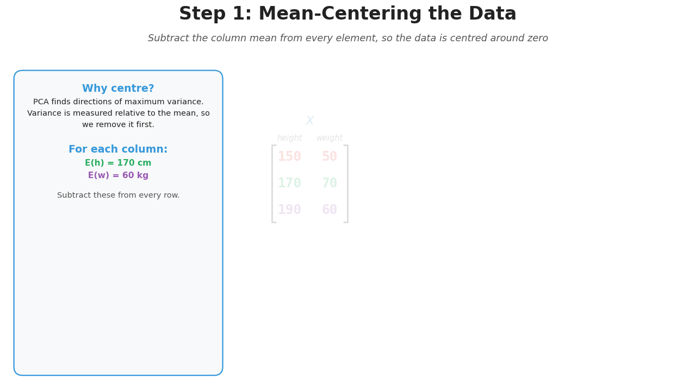

# pixelmotion

**Manim-style animated slides for math and computer vision, built on matplotlib.**



```python
import numpy as np
from pixelmotion import *

class BoxBlur(Slide):
    title = "Box Blur: A Sliding Window"
    info = ["# How it works", "Multiply the window by the kernel and add it up."]

    def construct(self):
        img = np.random.default_rng(0).integers(60, 200, (6, 6))
        left, mid, right = self.main.split(3)
        image = PixelGrid(img, center=left.center, label="Input image")
        kernel = Kernel(np.ones((3, 3)), scale="1/9", center=mid.center)
        output = PixelGrid.empty((4, 4), center=right.center, label="Output")
        self.play(Create(image), FadeIn(kernel), FadeIn(output))
        self.play(Convolve(image, kernel, output))

BoxBlur().render_gif("box_blur.gif")
```

- **Objects for what you teach.** Matrices, vectors, planes and linear maps,
  pixel grids, kernels, convolution, gradients, and every step of Canny, with
  features, detection, ML, and neural nets on the roadmap.
- **Slides, not videos.** 16:9 GIF/PNG output sized for PowerPoint.
- **Catches layout bugs.** Every frame is checked for colliding labels,
  including mid-animation.

📖 **Documentation: https://nalaquq.github.io/pixelmotion/**

## Install

```bash
pip install git+https://github.com/Nalaquq/pixelmotion
```

## Develop

```bash
python -m venv .venv && . .venv/bin/activate
pip install -e ".[dev,docs]"
pytest
python scripts/build_gallery.py && mkdocs serve   # docs at http://127.0.0.1:8000
```
